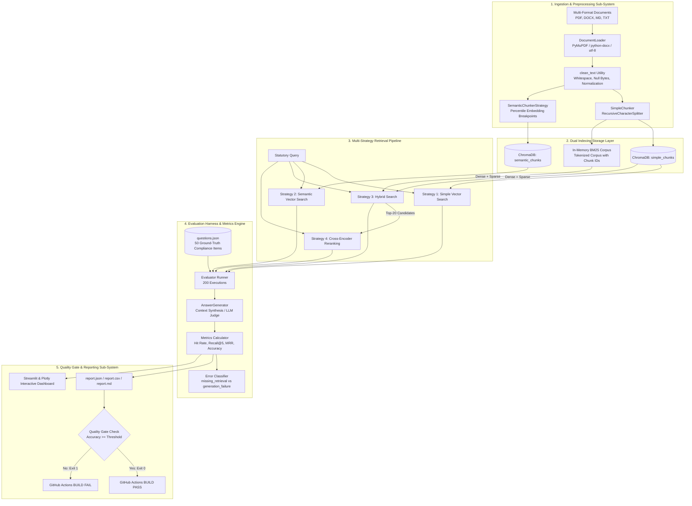

# 🏛️ System Architecture, Workflow Execution & Tech Stack Justification
## Enterprise RAG Evaluation Harness & CI/CD Quality Gate
**Target Role:** Senior AI Engineer / Enterprise GenAI Specialist (Enterprise & Regulated Systems)

---

## 📑 Table of Contents
1. [Executive Summary & Problem Statement](#1-executive-summary--problem-statement)
2. [End-to-End System Architecture](#2-end-to-end-system-architecture)
3. [Deep-Dive Workflow Execution Lifecycle](#3-deep-dive-workflow-execution-lifecycle)
4. [Tech Stack Justification & Trade-Off Analysis](#4-tech-stack-justification--trade-off-analysis)
5. [The 4 Retrieval Strategies: Mechanics & Math](#5-the-4-retrieval-strategies-mechanics--math)
6. [Evaluation Methodology & Metric Formulations](#6-evaluation-methodology--metric-formulations)
7. [Enterprise Interview Q&A Defense Guide](#7-enterprise-interview-qa-defense-guide)

---

## 1. Executive Summary & Problem Statement

### The Industry Challenge
In enterprise advisory, audit, compliance, and risk consulting (such as engagements with tier-1 financial institutions and conglomerates), clients operate under strict legal liability and regulatory oversight (e.g., **DPDP Act 2023**, **RBI Master Directions**, **SEBI BRSR Framework**). 

Deploying naive RAG (fixed chunking + cosine similarity on dense embeddings) in these environments fails because:
1. **Lexical Blindness**: Dense embeddings blur exact legal section numbers, statutory clauses, and numerical penalty thresholds (e.g., confusing *Section 33(1)* with *Section 33(2)*, or *₹250 crore* with *₹150 crore*).
2. **Context Fragmentation**: Naive chunk boundaries split statutory provisos ("*Provided that...*") away from parent obligations.
3. **Silent Regressions**: Engineers often tweak prompt templates, chunk sizes, or embedding models without realizing that retrieval on critical edge-cases degraded.

### The Solution
This project provides an automated, objective evaluation harness that benchmarks **4 retrieval strategies** across a **50-question ground-truth statutory dataset (200 evaluations)** and integrates a **GitHub Actions CI/CD Quality Gate** that automatically fails the build if accuracy drops below a configurable threshold.

---

## 2. End-to-End System Architecture

The architecture enforces strict separation of concerns across 5 modular sub-systems:



---

## 3. Deep-Dive Workflow Execution Lifecycle

### Stage 1: Ingestion & Document Provenance
* **Loader (`src/ingestion/loaders.py`)**: Recursively scans `data/documents/`. Uses lazy imports for compiled C-libraries (`fitz` / `docx`) to enable graceful degradation across environments.
* **Cleaning (`src/ingestion/cleaners.py`)**: Removes null bytes, merges multiple spaces (`re.sub(r' {2,}', ' ')`), and collapses triple-newlines while preserving single paragraph delimiters.
* **Metadata Attachment**: Every document receives a deterministic `document_id`, `source`, `file_name`, and `file_type`.

### Stage 2: Dual Chunking & Deterministic ID Assignment
* **Simple Chunking (`SimpleChunker`)**: 800-character windows with 100-character overlap.
* **Semantic Chunking (`SemanticChunkerStrategy`)**: Uses `all-MiniLM-L6-v2` embeddings to measure cosine distance between consecutive sentences. Chunks split dynamically at the 90th percentile difference.
* **Chunk ID Architecture**: Every chunk receives a traceable, audit-ready ID:
  $$\text{chunk\_id} = \text{document\_id} + \text{"\_page\_"} + \text{page} + \text{"\_"} + \text{strategy} + \text{"\_"} + i$$
  *Example:* `dpdp_act_2023.md_simple_18` (directly mapping to Section 33 Penalties).

### Stage 3: Indexing
* **Dense Vector Database**: ChromaDB collections persisted to disk (`chroma/simple_chunks` and `chroma/semantic_chunks`). Embeddings are processed in configurable batches of 100 to prevent OOM errors on large corpora.
* **Sparse Index**: Inverted index built in-memory via `rank_bm25` using tokenized representations of the exact same chunk corpus.

### Stage 4: Retrieval Dispatch
When a question is queried, the harness dispatches it to:
1. `VectorRetriever(strategy="simple")`: Returns Top-5 nearest neighbors via L2/Cosine space.
2. `VectorRetriever(strategy="semantic")`: Returns Top-5 semantic boundary chunks.
3. `HybridRetriever`: Fetches Top-10 dense candidates + Top-10 BM25 candidates, then fuses them using **Reciprocal Rank Fusion (RRF)** into a final Top-5.
4. `RerankerRetriever`: Fetches Top-20 candidates from Hybrid Retriever, constructs 20 query-document pairs, feeds them through `cross-encoder/ms-marco-MiniLM-L-6-v2`, and selects the Top-5 highest scoring passages.

### Stage 5: Evaluation & Answer Assessment
* **Metrics Computed**: Hit Rate, Recall@5, Precision@5, Mean Reciprocal Rank (MRR), and Latency (split into retrieval latency and generation latency).
* **Answer Accuracy**: Evaluated using LLM-as-a-judge (`gpt-4o-mini` / `llama-3.3-70b`) when an API key is present, with an automated factual entity-overlap fallback (extracting numbers like *₹250 crore*, *6 hours*, *3 days*, and statutory nouns).
* **Failure Classification (`error_analysis.py`)**:
  * If $\text{hit} = \text{False} \implies$ **`missing_retrieval`** (the chunk wasn't fetched).
  * If $\text{hit} = \text{True}$ but answer incorrect $\implies$ **`generation_failure`** (context was retrieved, but synthesis failed).

### Stage 6: CI/CD Quality Gate Execution
The script `quality_gate.py` reads `results/report.json`. It computes $\max(\text{Answer Accuracy})$. If this value is below `config.evaluation.threshold` (default: 70%), the script terminates with **`sys.exit(1)`**. In GitHub Actions, any non-zero exit code immediately halts the CI pipeline and blocks PR merging.

---

## 4. Tech Stack Justification & Trade-Off Analysis

| Technology | Role in System | Alternatives Considered | Why This Specific Tech Was Chosen |
|---|---|---|---|
| **Python 3.11+** | Core Language | Python 3.9 / 3.10 | 10–25% faster runtime performance, superior type hinting (`typing.Self`, improved union syntax), and modern async handling. |
| **LangChain Core** | Abstraction Layer | LlamaIndex, Haystack, Native Code | Provides lightweight, standard `Document` and `Retriever` interfaces without locking the codebase into a proprietary framework. |
| **ChromaDB** | Vector Database | Pinecone, Weaviate, Milvus, Qdrant | **Zero external server infrastructure needed.** Runs embedded in-process, supports metadata filtering, auto-persists to SQLite/parquet, and easily swaps behind our `VectorRetriever` abstraction. |
| **rank_bm25 (BM25Okapi)** | Sparse Keyword Retrieval | Elasticsearch, Apache Lucene, SPLADE | Pure Python, lightning-fast for in-memory token matching without the heavy JVM / Docker memory footprint of Elasticsearch. Perfect for exact legal citations (*Section 194C*, *Rule 14(2)*). |
| **sentence-transformers (`all-MiniLM-L6-v2`)** | Dense Embeddings | OpenAI `text-embedding-3-small`, Cohere | **100% offline, local, reproducible, and zero API cost.** Runs at ~5,000 sentences/sec on CPU. Guarantees that sensitive enterprise legal documents are never exfiltrated to third-party APIs during embedding. |
| **Cross-Encoder (`ms-marco-MiniLM-L-6-v2`)** | Neural Reranker | Cohere Rerank API, LLM-based prompting | Computes full cross-attention over `[Query, Document]` token pairs simultaneously. Outperforms bi-encoders by detecting nuanced semantic negations and exceptions. Free, runs locally, ~20ms per pair. |
| **Pydantic v2 + PyYAML** | Configuration Management | Python `os.environ`, `argparse` alone | Strict type validation, hierarchical configuration (`config.yaml`), and dynamic runtime environment variable overrides (`EVAL_THRESHOLD`, `EMBEDDING_MODEL`). |
| **Streamlit + Plotly** | Interactive Dashboard | React/FastAPI, Gradio | Allows rapid production of interactive Pareto frontiers, radar charts, and per-question inspection with zero frontend overhead. Can be deployed on Streamlit Cloud in 2 minutes. |
| **GitHub Actions** | CI/CD Quality Gate | Jenkins, GitLab CI | Native GitHub integration, automated test runners, artifact uploading, and regression prevention directly on pull requests. |

---

## 5. The 4 Retrieval Strategies: Mechanics & Math

### Strategy 1: Simple Chunking (Dense Bi-Encoder Baseline)
* **Chunking**: Recursive character splitting with chunk size 800 and overlap 100.
* **Retrieval**: Query embedding $\mathbf{q} = \text{Embed}(Q)$, Document embedding $\mathbf{d} = \text{Embed}(D)$.
* **Similarity**:
  $$\text{Cosine Similarity} = \frac{\mathbf{q} \cdot \mathbf{d}}{\|\mathbf{q}\| \|\mathbf{d}\|}$$
* **Limitation**: Bi-encoders map query and document independently into vector space. They fail when queries require exact alphanumeric keyword precision.

### Strategy 2: Semantic Chunking
* **Chunking**: Breaks text into individual sentences, computes embeddings, and calculates cosine distance between adjacent sentences. When the distance exceeds a statistical breakpoint (90th percentile), a chunk boundary is created.
* **Advantage**: Avoids arbitrary character splits; keeps complete legal clauses intact.
* **Limitation**: Generates variable chunk lengths (some very large), which can dilute vector similarity scores for short queries.

### Strategy 3: Hybrid Search (Dense + BM25 with Reciprocal Rank Fusion)
* **Mechanics**: Combines dense vector retrieval ($R_{\text{dense}}$) with sparse BM25 retrieval ($R_{\text{BM25}}$).
* **Why Reciprocal Rank Fusion (RRF)?**
  Cosine similarity scores ($[0, 1]$) and BM25 scores ($[0, \infty)$) have incompatible probability distributions and cannot be simply added. RRF operates purely on **ranks**, making it scale-invariant:
  $$\text{RRF Score}(d) = \sum_{m \in \{\text{dense}, \text{bm25}\}} \frac{1}{k + r_m(d)}$$
  *(where $k = 60$ is a smoothing constant, and $r_m(d)$ is the rank of document $d$ in retriever $m$).*

### Strategy 4: Cross-Encoder Neural Reranking
* **Mechanics**:
  1. Retrieve initial candidate pool ($N = 20$) using Hybrid Search.
  2. Feed both query $Q$ and passage $D$ concatenated into a BERT cross-encoder:
     $$\text{Input} = [\text{CLS}] \circ Q \circ [\text{SEP}] \circ D \circ [\text{SEP}]$$
  3. Every query token attends to every document token across all transformer layers (full self-attention).
  4. Output a single uncalibrated relevance score $s \in (-\infty, +\infty)$ from the `[CLS]` token head.
  5. Sort descending and take Top-$K$ ($K = 5$).

```
                    ┌───────────────────────────┐
                    │  Query + Candidate Pool   │
                    └─────────────┬─────────────┘
                                  │
                                  ▼
           Bi-Encoder (Fast, Independent Vector Embeddings)
              q = Embed(Q)       d_i = Embed(D_i)
                        \         /
                    Cosine Similarity
                                  │
                                  ▼
                    Top-20 Initial Candidates
                                  │
                                  ▼
         Cross-Encoder (Deep Full Cross-Attention Layers)
          All tokens of Q interact with all tokens of D_i
                                  │
                                  ▼
                    Top-5 High-Precision Chunks
```

---

## 6. Evaluation Methodology & Metric Formulations

### 1. Hit Rate
$$\text{Hit Rate} = \begin{cases} 1 & \text{if } \text{Top-K retrieved chunks} \cap \text{Ground Truth Chunks} \neq \emptyset \\ 0 & \text{otherwise} \end{cases}$$

### 2. Recall@K
$$\text{Recall@K} = \frac{|\text{Retrieved Chunks} \cap \text{Ground Truth Chunks}|}{|\text{Ground Truth Chunks}|}$$

### 3. Precision@K
$$\text{Precision@K} = \frac{|\text{Retrieved Chunks} \cap \text{Ground Truth Chunks}|}{K}$$

### 4. Mean Reciprocal Rank (MRR)
Measures the position of the **first relevant document**:
$$\text{MRR} = \frac{1}{|Q|} \sum_{i=1}^{|Q|} \frac{1}{\text{rank}_i}$$
*(If no relevant chunk is retrieved in Top-K, $\frac{1}{\text{rank}_i} = 0$).*

### 5. Answer Accuracy
Binary metric determined by comparing generated output to ground truth. Evaluated via LLM-as-a-judge prompt or deterministic factual token extraction.

---

## 7. Enterprise Interview Q&A Defense Guide

### Q1: "Why did you build an automated evaluation harness instead of just picking Hybrid Search or Reranking from the start?"
> **Answer:**  
> *"In enterprise consulting, choosing an architecture without quantitative benchmarking is guesswork. Different domains possess different lexical-to-semantic ratios. For example, clinical trial protocols or Indian statutory regulations (DPDP Act, RBI Directions) require exact section and penalty lookups where dense vectors struggle.*  
> *We built this harness to prove empirically which method works best, measure the latency penalty of neural reranking, and establish an automated CI/CD Quality Gate so that future changes to chunk size or embedding models cannot silently regress compliance accuracy."*

---

### Q2: "Look at your benchmark results: Reranking has 97.0% MRR at 430 ms, while Hybrid has 90.5% MRR at 18 ms. How do you advise an enterprise client on which one to deploy?"
> **Answer (The Pareto Trade-off):**  
> *"It depends on whether the workload is interactive or asynchronous:*  
> 1. *For Real-Time Conversational Agents (Chatbots): Deploy **Hybrid Search**. At 18 ms latency, it consumes virtually zero token budget and leaves the entire latency SLA for LLM token generation, while still providing a robust 90.5% MRR.*  
> 2. *For Automated Legal Audit, Forensic Review, or Due Diligence: Deploy **Cross-Encoder Reranking**. In forensic investigations or compliance audits, an extra 400 ms per query is imperceptible to an auditor running batch reports, but jumping from 90.5% to 97.0% MRR eliminates false negatives on multimillion-rupee statutory penalties."*

---

### Q3: "Why use Reciprocal Rank Fusion (RRF) instead of a weighted linear combination of dense and sparse scores?"
> **Answer:**  
> *"A weighted linear combination ($\alpha \cdot S_{\text{dense}} + (1-\alpha) \cdot S_{\text{BM25}}$) requires score normalization. But dense cosine similarities are bounded in $[-1, 1]$ (or $[0, 1]$), while BM25 scores are unbounded and depend on term frequency and document length distribution.*  
> *Linear combinations require careful heuristic tuning of $\alpha$ that often overfits to the test queries. RRF is **scale-free**—it converts arbitrary score distributions into discrete rank orders and uses a standard reciprocal harmonic series ($1 / (k + r)$), guaranteeing robust fusion without score calibration."*

---

### Q4: "How does your CI/CD quality gate work, and how does it prevent production regressions?"
> **Answer:**  
> *"Our evaluation runner outputs structured metrics in `results/report.json`. The CI step calls `python -m src.evaluation.quality_gate`, which parses the best accuracy across strategies and compares it to a configurable threshold (e.g., 70%).*  
> *If accuracy drops below the threshold—perhaps because a junior engineer changed chunk overlap from 100 to 20, cutting off statutory definitions—the script exits with `sys.exit(1)`. In GitHub Actions, this halts the pipeline, marks the PR with a red cross, and blocks merging until the regression is resolved."*

---

### Q5: "How did you categorize errors in your failure analysis?"
> **Answer:**  
> *"We separated retrieval failures from generation failures using our `error_analysis.py` module:*  
> * 1. **`missing_retrieval`**: Top-K retrieved chunks do not contain the ground-truth chunk ID. This indicates an upstream issue: either chunk boundaries severed the context, or the embedding model failed to associate the query with the document. Remedy: adjust chunking parameters or use reranking.*  
> * 2. **`generation_failure`**: The correct chunk was retrieved, but the generated answer was incorrect. This indicates a downstream issue: prompt instruction ambiguity, context window truncation, or LLM hallucination. Remedy: improve system prompt constraints or switch to a higher-parameter LLM."*

---

### Q6: "How would you scale this architecture from 4 documents to 500,000 enterprise documents?"
> **Answer:**  
> *"We would introduce four architectural enhancements:*  
> 1. **Distributed Vector Database**: Replace embedded ChromaDB with **Qdrant** or **Milvus** clustered on Kubernetes, utilizing HNSW indexing with scalar quantization (SQ8) to reduce RAM consumption by 75%.  
> 2. **Distributed Sparse Search**: Move BM25 from in-memory Python into an **Elasticsearch** or **OpenSearch** cluster with sharding.  
> 3. **Hierarchical / Metadata Pre-Filtering**: Add mandatory metadata filtering on `department`, `document_type`, and `effective_date` before running vector search, shrinking the search space by 90%.  
> 4. **Asynchronous Batch Evaluation**: Utilize Celery or Ray with Redis queues to evaluate the 50 questions concurrently across worker nodes."*
