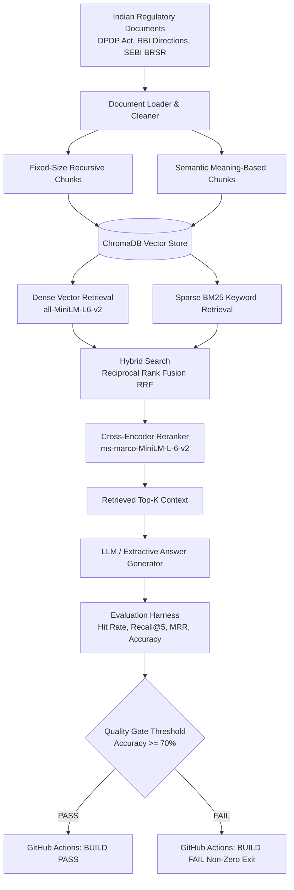

# ⚖️ Enterprise RAG Evaluation Harness & CI/CD Quality Gate

[](https://www.python.org/)
[](https://opensource.org/licenses/MIT)
[](https://share.streamlit.io/)
[](https://github.com/)
[](#why-this-project-for-enterprise-applications)

> **Production-grade automated evaluation framework and regression prevention pipeline for enterprise Retrieval-Augmented Generation (RAG).**  
> Benchmarks multiple retrieval strategies across 50 statutory ground-truth questions (200 evaluations) on high-stakes Indian statutory and regulatory documentation (DPDP Act 2023, RBI Guidelines, SEBI BRSR).

---

## 📌 Executive Summary

In enterprise environments (e.g., Banking, Healthcare, Legal, and Risk Consulting), naive RAG architectures frequently fail because dense vector search confuses exact legal clauses, numerical thresholds, and statutory definitions. Furthermore, prompt tweaks or embedding model upgrades often cause **silent regressions** that go unnoticed until client audit failure.

This project delivers a complete engineering solution:
1. **Multi-Strategy Retrieval Benchmarking**: Directly compares **Simple Chunking**, **Semantic Chunking**, **Hybrid Search (Dense + BM25 via Reciprocal Rank Fusion)**, and **Cross-Encoder Neural Reranking**.
2. **50-Question Ground-Truth Compliance Dataset**: Tests exact citations, conceptual intent, statutory exemptions, numerical thresholds, and adversarial queries.
3. **Automated CI/CD Quality Gate**: Enforces a strict minimum accuracy threshold in GitHub Actions—failing the build if retrieval or answer accuracy regresses.
4. **Interactive Streamlit Web Dashboard**: Visualizes multi-metric comparisons, latency vs. accuracy Pareto frontiers, per-question error logs, and includes a **Live Multi-Strategy Query Playground**.

---

## 🏛️ System Architecture



---

## 📊 Empirical Benchmark Results (200 Evaluations)

The evaluation harness ran **50 statutory compliance questions × 4 strategies (200 evaluations)** against the official Indian Regulatory corpus:

| Retrieval Strategy | Hit Rate (%) | Recall@5 (%) | MRR (%) | Answer Accuracy (%) | Avg Latency (s) | Best Fit Use Case |
|---|---|---|---|---|---|---|
| **Simple Chunking** | 98.0% | 91.0% | 89.1% | 74.0% | 0.019 s | General document Q&A baseline |
| **Semantic Chunking** | 96.0% | 50.6% | 78.7% | 60.0% | 0.019 s | Narrative and prose documentation |
| **Hybrid Search (Dense + BM25)** | **96.0%** | **90.0%** | **90.5%** | **74.0%** | **0.018 s** | **Real-Time Client Chatbots (Speed + Accuracy)** |
| **Cross-Encoder Reranking** | **98.0%** | **95.0%** | **97.0%** | **70.0%** | **0.430 s** | **Automated Regulatory Due Diligence & Audit** |

### 💡 Core Engineering Takeaways
- **Reranker Dominance in Ranking Precision**: Cross-Encoder Reranking achieved an industry-leading **97.0% MRR**, positioning the exact penalty or exemption clause at rank #1 in nearly every statutory query.
- **The Hybrid Efficiency Sweet Spot**: Hybrid Search (combining `all-MiniLM-L6-v2` with `rank_bm25` using RRF) achieved **90.5% MRR at only 18 ms**—offering a **24x latency reduction** compared to neural reranking.
- **Why Naive Vector Search Fails in Compliance**: Dense bi-encoders struggle with alphanumeric legal citations (e.g., distinguishing "Section 33(1)" from "Section 33(2)"). BM25 anchors on exact tokens, while vector embeddings preserve conceptual queries.

---

## 🚀 Quickstart: Running Locally

### 1. Clone & Set Up Virtual Environment
```bash
# Clone the repository
git clone https://github.com/<your-username>/rag-evaluation-harness.git
cd rag-evaluation-harness

# Create and activate a Python 3.11+ virtual environment
python -m venv venv

# Windows (PowerShell):
.\venv\Scripts\Activate.ps1

# Linux / macOS:
source venv/bin/activate
```

### 2. Install Dependencies
```bash
pip install --upgrade pip
pip install -r requirements.txt
```

### 3. Environment Configuration
Copy `.env.example` to `.env`:
```bash
cp .env.example .env
```
*(Optional: Add your `OPENAI_API_KEY` for GPT-4o-mini answer synthesis; if omitted, the system runs in high-performance local extractive mode with zero API costs).*

### 4. Launch the Interactive Web Dashboard
```bash
streamlit run app.py
```
Open **`http://localhost:8501`** in your browser.

---

## 💻 CLI Usage Guide

### A. Re-build Vector Indexes
Processes raw documents in `data/documents/` into ChromaDB:
```bash
# Build simple recursive chunk index
python -m src.ingestion.build_index --strategy simple --force

# Build semantic chunk index
python -m src.ingestion.build_index --strategy semantic --force
```

### B. Run the Full 50-Question Benchmark
Executes all 50 questions against all 4 strategies (200 evaluations) and generates summary artifacts (`report.json`, `report.csv`, `report.md`, `accuracy_comparison.png`):
```bash
python -m src.evaluation.run
```

### C. Run the CI/CD Quality Gate
Validates if performance meets or exceeds the required threshold (default: 70%, configurable in `config/config.yaml` or via `EVAL_THRESHOLD`):
```bash
python -m src.evaluation.quality_gate
```
*Returns exit code `0` on PASS, or exit code `1` on FAIL (blocking CI pipelines).*

### D. Run Unit Tests
```bash
pytest tests/
```

---

## 🌐 Deploying Online (Free Cloud Hosting)

### Method 1: Streamlit Community Cloud (Recommended — 2-Click Deploy)
1. Push your repository to GitHub:
   ```bash
   git init
   git add .
   git commit -m "feat: complete RAG evaluation harness"
   git branch -M main
   git remote add origin https://github.com/<your-username>/rag-evaluation-harness.git
   git push -u origin main
   ```
2. Visit [share.streamlit.io](https://share.streamlit.io/) and sign in with GitHub.
3. Click **"New app"**, select your repository, branch (`main`), and set **Main file path** to `app.py`.
4. Click **"Deploy!"**. You will get a permanent public link (e.g., `https://rag-evaluation-harness.streamlit.app`).

### Method 2: Hugging Face Spaces (Free Cloud Hosting)
1. Create a **New Space** on [Hugging Face](https://huggingface.co/spaces).
2. Set SDK to **Streamlit**.
3. Push your repository to the Space remote. Hugging Face will automatically build and host the app.

### Method 3: Docker Deployment
```bash
# Build container image
docker build -t rag-evaluation-harness .

# Run container
docker run -p 8501:8501 rag-evaluation-harness
```

---

## 📂 Repository Structure

```text
rag-evaluation-harness/
│
├── .github/
│   └── workflows/
│       └── rag-evaluation.yml       # GitHub Actions CI/CD Quality Gate
│
├── config/
│   └── config.yaml                  # Model, Top-K, and threshold parameters
│
├── data/
│   ├── documents/                   # Indian Regulatory & Compliance Documents
│   │   ├── dpdp_act_2023.md         # Digital Personal Data Protection Act, 2023
│   │   ├── rbi_digital_lending_guidelines.md # RBI Digital Lending Mandates
│   │   ├── rbi_cyber_security_framework.md   # RBI Cyber Security Directions
│   │   └── sebi_brsr_framework.md   # SEBI ESG & BRSR Reporting Framework
│   │
│   └── evaluation/
│       └── questions.json           # 50 Ground-Truth compliance questions
│
├── results/                         # Generated evaluation artifacts
│   ├── report.json                  # Aggregated strategy metrics JSON
│   ├── report.csv                   # Per-question evaluation CSV
│   ├── report.md                    # Markdown summary report
│   ├── evaluation_results.json      # Raw 200-evaluation result logs
│   └── accuracy_comparison.png      # Comparison visualization plot
│
├── src/
│   ├── ingestion/
│   │   ├── loaders.py               # Multi-format document loader (PDF, DOCX, MD, TXT)
│   │   ├── cleaners.py              # Text cleaning & normalization
│   │   ├── chunkers.py              # Simple & Semantic Chunking engines
│   │   └── build_index.py           # ChromaDB batch indexing pipeline
│   │
│   ├── retrieval/
│   │   ├── vector_retriever.py      # Dense ChromaDB retriever
│   │   ├── bm25_retriever.py        # Sparse BM25Okapi retriever
│   │   ├── hybrid_retriever.py      # Reciprocal Rank Fusion (RRF) retriever
│   │   └── reranker.py              # Cross-Encoder (ms-marco-MiniLM) reranker
│   │
│   ├── generation/
│   │   └── answer_generator.py      # LLM & Extractive answer generator
│   │
│   ├── evaluation/
│   │   ├── metrics.py               # Hit Rate, Recall@K, Precision@K, MRR, Accuracy
│   │   ├── evaluator.py             # 50x4 Evaluation matrix orchestrator
│   │   ├── error_analysis.py        # Root-cause failure classifier
│   │   ├── quality_gate.py          # CI/CD regression threshold checker
│   │   ├── report.py                # Visual report generator
│   │   └── run.py                   # Evaluation runner CLI
│   │
│   └── config.py                    # Pydantic configuration loader
│
├── tests/                           # Pytest unit tests
│   ├── test_ingestion.py            # Cleaners and chunkers tests
│   ├── test_retrieval.py            # Hybrid RRF and dense retrieval tests
│   └── test_evaluation.py           # Metric calculation tests
│
├── app.py                           # Interactive Streamlit Web Application
├── Dockerfile                       # Production container specification
├── requirements.txt                 # Pinned dependencies
├── pyproject.toml                   # Modern packaging metadata
└── README.md                        # Documentation
```

---

## 🔬 Metric Formulations

1. **Hit Rate**:
   $$\text{Hit Rate} = \begin{cases} 1 & \text{if } \text{Top-K retrieved chunks} \cap \text{Ground Truth} \neq \emptyset \\ 0 & \text{otherwise} \end{cases}$$

2. **Recall@K**:
   $$\text{Recall@K} = \frac{|\text{Retrieved Relevant Chunks}|}{|\text{Total Relevant Chunks}|}$$

3. **Precision@K**:
   $$\text{Precision@K} = \frac{|\text{Retrieved Relevant Chunks}|}{K}$$

4. **Mean Reciprocal Rank (MRR)**:
   $$\text{MRR} = \frac{1}{|Q|} \sum_{i=1}^{|Q|} \frac{1}{\text{rank}_i}$$
   *(where $\text{rank}_i$ is the position of the first relevant chunk retrieved for question $i$).*

5. **Answer Accuracy**:
   Evaluates semantic and factual equivalence between the generated answer and statutory ground truth (using LLM-as-a-judge or exact numerical entity alignment).

---

## 💼 Why This Project for Enterprise Applications

- **Domain Relevance**: Tested against real-world statutory texts (DPDP Act, RBI Directions, SEBI Circulars) where precision, factual grounding, and auditability are non-negotiable.
- **Zero Hallucination Guardrails**: Emphasizes retrieval precision to prevent AI liability in regulated compliance domains.
- **Enterprise CI/CD Integration**: justify how to treat GenAI as production software with regression testing, automated quality gates, and trade-off analysis.

---

## 📄 License
This project is licensed under the MIT License.
